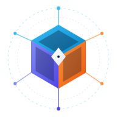
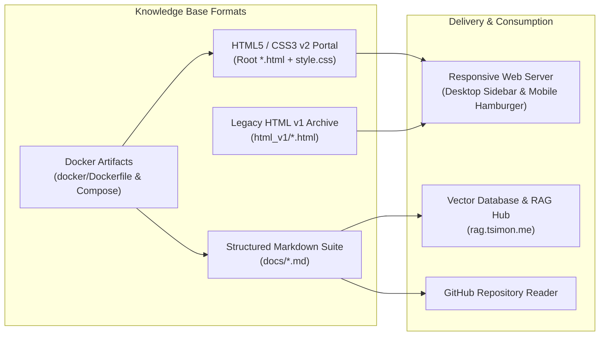

<div align="center">



# Technical Documentation Wiki & SysAdmin Knowledge Base

**Exhaustive Linux/Unix System Administration, Networking, Security, DevOps & Programming Reference**

[](https://rag.tsimon.me)
[-0084b8?style=for-the-badge)](index.html)
[](https://www.freecodecamp.org/)
[](LICENSE)

[](index.html)
[](style.css)
[](docs/README.md)
[](linuxtools.html)
[](bash.html)
[](docker-administration.html)
[](common-sql-commands.html)
[](ssl-tips-and-tricks.html)
[](git-and-guthub-memo.html)
[-00ADD8?style=flat-square&logo=go&logoColor=white)](go-golang.html)

---

[**Live RAG Knowledge Hub (`rag.tsimon.me`)**](https://rag.tsimon.me) · [**Markdown Documentation (`docs/`)**](docs/README.md) · [**HTML v2 Portal (`index.html`)**](index.html) · [**Legacy HTML v1 (`html_v1/`)**](html_v1/index.html) · [**Author Website (`tsimon.me`)**](https://tsimon.me)

</div>

---

## 📌 Project Overview & Purpose

Initially created as part of the **freeCodeCamp Responsive Web Design Certification** (*Technical Documentation Page* project), this repository serves as a centralized, zero-dependency **System Administration, DevOps, Security, and Programming Knowledge Base** authored by **Thomas Simon**.

It is designed around three core objectives:
1. **Fast Operational Reference:** Provide copy-pasteable command-line recipes, shell one-liners, firewall rules, SQL administration procedures, OpenSSL workflows, and Docker stacks for daily Linux/Unix engineering.
2. **Pure, Dependency-Free Web Standards:** Deliver a fast, accessible, responsive web portal built in pure **HTML5** and **CSS3** without heavy JavaScript frameworks.
3. **AI & Vector Database Ingestion (RAG):** Provide a clean, hierarchically structured **Markdown (`docs/`)** twin of the entire knowledge base specifically engineered for chunking and ingestion into vector databases for **Retrieval-Augmented Generation (RAG)**.

---

## 🚀 Project Status & 2026 RAG Evolution

> [!IMPORTANT]
> **[EDIT 10/25/2026 — T. Simon] Edge Semantic Search & RAG Knowledge Hub:**
> A Retrieval-Augmented Generation (RAG) platform has been built at **[rag.tsimon.me](https://rag.tsimon.me)**. New technical documentation and ongoing updates are indexed into its vector database. You can request access on the [login page](https://rag.tsimon.me) of the tool with your email.

| Component | Path | Status | Description |
| :--- | :--- | :---: | :--- |
| **RAG Knowledge Hub** | [`https://rag.tsimon.me`](https://rag.tsimon.me) |  | Edge Semantic Search & Vector Database Knowledge Hub |
| **HTML v2 Web Portal** | [`/` (Root)](index.html) |  | Responsive HTML5/CSS3 site with mobile frosted-glass hamburger navigation |
| **Markdown Corpus** | [`docs/`](docs/README.md) |  | Structured Markdown files formatted for vector DB import & GitHub browsing |
| **Docker Configurations** | [`docker/`](docker/) |  | Production-style `docker-compose.yml` stacks & Kali Linux `Dockerfile` templates |
| **HTML v1 Legacy Site** | [`html_v1/`](html_v1/index.html) |  | Original multi-page HTML v1 wiki preserved for historical reference |

---

## 📚 Exhaustive Content Matrix

Every topic in this repository is available across **three formats**: the **Responsive HTML v2 Web Portal**, the **RAG-Ready Markdown Suite (`docs/`)**, and the **Legacy HTML v1 Archive (`html_v1/`)**.

| # | Domain / Topic | HTML v2 Page (Root) | Markdown Guide (`docs/`) | Legacy HTML v1 (`html_v1/`) | Key Subjects & Commands Covered |
| :-: | :--- | :--- | :--- | :--- | :--- |
| **0** | **Main Index & Overview** | [`index.html`](index.html) | [`docs/README.md`](docs/README.md) | [`html_v1/index.html`](html_v1/index.html) | Executive summary of all sections, Vi quick-sheet, LDAP queries, and curated links |
| **1** | **Bash & Shell Scripting** | [`bash.html`](bash.html) | [`docs/bash.md`](docs/bash.md) | [`html_v1/bash.html`](html_v1/bash.html) | `for` loops, quoting, ANSI terminal colors, exit codes, `STDIN`/`STDOUT`/`STDERR` redirection, `$1..$n` positional args, `ps`, WSL backup, VMware `.bat` |
| **2** | **Linux & Unix Tools** | [`linuxtools.html`](linuxtools.html) | [`docs/linux-tools.md`](docs/linux-tools.md) | [`linuxtools1.html`](html_v1/linuxtools1.html)<br>[`linuxtools2.html`](html_v1/linuxtools2.html)<br>[`linuxtools3.html`](html_v1/linuxtools3.html) | `sed`, `echo`, `cut`, `grep` (including PHP backdoor/shell detection), `find`, `cron`, `set`, `awk`, `$IFS`, `rename`, `shred`, `rclone`, `rsync` |
| **3** | **Vi & Vim Basics** | [`index.html#Vi_Basics`](index.html#Vi_Basics) | [`docs/vi-basics.md`](docs/vi-basics.md) | [`html_v1/vi.html`](html_v1/vi.html) | Global regex search & replace (`:i,$ s/.../...`), block editing (`Ctrl+V`), increment/decrement (`Ctrl+A`/`Ctrl+X`), navigation & line deletion shortcuts |
| **4** | **Useful Misc. Commands** | [`usefulcommands.html`](usefulcommands.html) | [`docs/useful-commands.md`](docs/useful-commands.md) | [`html_v1/miscallenous.html`](html_v1/miscallenous.html) | `wget`, `curl` headers, `netstat` monitoring with `watch`, NFS mounts, `ccze` log colorization, `lsof`, `systemctl`, `dpkg`/`apt`, disk/CPU checks |
| **5** | **SSH, DSH, SCP, PTS & TTY** | [`ssh-pts-tty.html`](ssh-pts-tty.html) | [`docs/ssh-pts-tty.md`](docs/ssh-pts-tty.md) | [`html_v1/ssh.html`](html_v1/ssh.html) | Shell vs. Console vs. Terminal, TTY vs. PTS architecture, SSH local port forwarding (`ssh -L`), `ssh-agent`, key passphrase updates, `dsh`, `scp` |
| **6** | **Iptables & Networking** | [`iptables-and-network-management.html`](iptables-and-network-management.html) | [`docs/iptables-and-network.md`](docs/iptables-and-network.md) | [`html_v1/network.html`](html_v1/network.html) | `tcpdump` packet captures, `route` & `ip route`, `arp`, `dig`, `iptables` filter/NAT rules, port forwarding, logging, `iptables-save` persistence |
| **7** | **Common SQL Commands** | [`common-sql-commands.html`](common-sql-commands.html) | [`docs/sql.md`](docs/sql.md) | [`html_v1/sql.html`](html_v1/sql.html) | MySQL/MariaDB inspection, database/table sizes, user creation & `GRANT` privileges, `mysqldump`, cold backups, automated rotation backup script |
| **8** | **SSL, OpenSSL & HSTS** | [`ssl-tips-and-tricks.html`](ssl-tips-and-tricks.html) | [`docs/ssl-tips-and-tricks.md`](docs/ssl-tips-and-tricks.md) | [`html_v1/ssl.html`](html_v1/ssl.html) | 4096-bit Diffie-Hellman key generation (`dhparam`), CSR & X.509 inspection, `openssl s_client` TLS debugging, AES-256-CBC file encryption, Nginx HSTS |
| **9** | **Docker & Compose** | [`docker-administration.html`](docker-administration.html) | [`docs/docker.md`](docs/docker.md) | [`html_v1/docker.html`](html_v1/docker.html) | Docker installation, CLI reference, container linking, volume mounts, multi-container `docker-compose.yml` LEMP stack, Kali X11 `Dockerfile` builds |
| **10** | **Git, GitHub & Atom** | [`git-and-guthub-memo.html`](git-and-guthub-memo.html) | [`docs/git-and-github.md`](docs/git-and-github.md) | [`html_v1/git-atom.html`](html_v1/git-atom.html) | Branching, merging, safe reset (`--soft` + `git stash`) vs. `--hard`, repository initialization, purging sensitive folders via `git filter-branch`, Atom shortcuts |
| **11** | **Go (Golang) Notes** | [`go-golang.html`](go-golang.html) | [`docs/go-golang.md`](docs/go-golang.md) | [`html_v1/go.html`](html_v1/go.html)<br>[`html_v1/go2.html`](html_v1/go2.html) | Cross-compilation (`GOOS`/`GOARCH`), `GOPATH` workspace, Go CLI, `fmt` verbs, custom packages, `iota` bit-shifting constants, closures, pointers |
| **12** | **LDAP & Resources** | [`index.html#Useful_Resources`](index.html#Useful_Resources) | [`docs/ldap-and-resources.md`](docs/ldap-and-resources.md) | [`html_v1/resources.html`](html_v1/resources.html) | `ldapsearch` directory queries by canonical name (`cn`) and organization (`o`/`ou`), plus curated security, Linux, HTTP, and Nginx reference links |

---

## 🏗️ Architecture, Methods & Design Standards



### 1. Responsive Web Design & Mobile Glassmorphism (`style.css`)
- **Desktop Layout (`> 800px`):** Fixed full-height left navigation sidebar (`#navbar`, `300px` width) paired with a fluid main documentation container (`#main-doc`) using Flexbox and semantic `<section class="main-section">`, `<header>`, `<article>`, and `<code>` blocks.
- **Mobile & Tablet Layout (`<= 800px`):**
  - Transforms `#navbar` into a fixed top header bar with a **3-line Hamburger Menu button** (`.hamburger-btn`) that starts **folded** (`max-height: 0; opacity: 0`) and animates into an `X` when expanded (`#navbar.nav-open`).
  - Uses **50% background transparency** (`background-color: rgba(250, 250, 250, 0.5)`) combined with a **frosted-glass blur effect** (`backdrop-filter: blur(10px) saturate(150%)`), crisp `font-weight: 600` typography, and halo `text-shadow` so navigation links remain highly readable over underlying code and text.
  - Automatically collapses the dropdown menu when an in-page anchor link is selected.
- **Ultra-Low Resolution Support (`<= 640px`):** Adjusts `<code>` blocks (`white-space: normal`) and container margins so long shell pipelines wrap cleanly without horizontal viewport overflow.
- **Inline Highlighting & Callouts:** Provides `.read-more-button` and `.highlight-text` gradient classes (`linear-gradient(90deg, #9999dd, #99bbdd)`) for visual callouts inside paragraphs and section summaries.

### 2. Multi-Platform Favicon & Web App Icons
All root pages (`*.html`) and sub-folder pages (`html_v1/*.html` / `v1/*.html`) include complete icon declarations:
- `favicon.ico` (legacy & standard browser icon)
- `favicon-16x16.png` & `favicon-32x32.png` (standard PNG favicons)
- `apple-touch-icon.png` (`180x180` iOS home screen icon)
- `android-chrome-192x192.png` & `android-chrome-512x512.png` (Android / PWA icons)

### 3. Vector Database & RAG Readiness (`docs/`)
- Every HTML topic was converted into clean, semantic Markdown inside [`docs/`](docs/README.md) (see commit `0d22bb2`).
- Heading hierarchies (`#`, `##`, `###`), fenced code blocks with language tags (`bash`, `sql`, `go`, `yaml`, `dockerfile`, `nginx`, `vim`), and Markdown tables are strictly formatted for high-precision semantic chunking and embedding generation in **[rag.tsimon.me](https://rag.tsimon.me)**.

---

## 📂 Repository Directory Structure

```text
wiki/
├── index.html                                # Main HTML v2 landing page & topic summaries
├── bash.html                                 # Bash & shell scripting guide
├── linuxtools.html                           # Linux & Unix CLI tools guide
├── usefulcommands.html                       # Useful miscellaneous sysadmin commands
├── ssh-pts-tty.html                          # SSH, DSH, SCP, PTS & TTY guide
├── iptables-and-network-management.html      # Iptables firewall & Linux networking guide
├── common-sql-commands.html                  # MySQL / SQL administration & backup scripts
├── ssl-tips-and-tricks.html                  # OpenSSL, HTTPS/HSTS & cryptography guide
├── docker-administration.html                # Docker & Docker Compose administration guide
├── git-and-guthub-memo.html                  # Git, GitHub & Atom memo
├── go-golang.html                            # Go (Golang) programming notes
├── style.css                                 # Responsive CSS3 stylesheet (Desktop + Mobile Hamburger)
├── favicon.ico                               # Multi-size ICO favicon
├── favicon-16x16.png                         # 16x16 PNG favicon
├── favicon-32x32.png                         # 32x32 PNG favicon
├── apple-touch-icon.png                      # 180x180 Apple Touch icon
├── android-chrome-192x192.png                # 192x192 Android Chrome icon
├── android-chrome-512x512.png                # 512x512 Android Chrome icon
├── LICENSE                                   # GNU General Public License v3.0
├── README.md                                 # Repository documentation (this file)
│
├── docker/                                   # Docker & Docker Compose reference artifacts
│   ├── Dockerfile                            # Kali Linux security container examples with X11 forwarding
│   ├── Dockerfile.txt                        # Plain-text viewable copy of Dockerfile
│   ├── docker-compose.yml                    # Full Nginx + PHP-FPM + MariaDB + phpMyAdmin stack (EFS)
│   ├── docker-compose.yml.txt                # Plain-text viewable copy of docker-compose.yml
│   └── docker-compose-2.yml                  # Nginx + PHP-FPM stack (/var/www bind mount)
│
├── docs/                                     # RAG-ready structured Markdown documentation
│   ├── README.md                             # Markdown documentation index & quick reference
│   ├── bash.md                               # Bash & shell scripting (Markdown)
│   ├── docker.md                             # Docker & Docker Compose (Markdown)
│   ├── git-and-github.md                     # Git, GitHub & Atom memo (Markdown)
│   ├── go-golang.md                          # Go (Golang) programming notes (Markdown)
│   ├── iptables-and-network.md               # Iptables & network management (Markdown)
│   ├── ldap-and-resources.md                 # LDAP queries & curated links (Markdown)
│   ├── linux-tools.md                        # Linux & Unix command-line tools (Markdown)
│   ├── sql.md                                # Common SQL commands & backup script (Markdown)
│   ├── ssh-pts-tty.md                        # SSH, DSH, SCP, PTS & TTY (Markdown)
│   ├── ssl-tips-and-tricks.md                # SSL, OpenSSL & HTTPS/HSTS (Markdown)
│   ├── useful-commands.md                    # Useful miscellaneous commands (Markdown)
│   └── vi-basics.md                          # Vi & Vim basics (Markdown)
│
└── html_v1/                                  # Legacy HTML v1 Wiki archive (deployed as /v1 on web server)
    ├── README.md                             # HTML v1 index overview
    ├── index.html                            # HTML v1 main index page
    ├── style.css                             # HTML v1 stylesheet
    ├── template.html                         # HTML v1 page boilerplate template
    ├── bash.html                             # Bash shell tips (v1)
    ├── docker.html                           # Docker memo (v1)
    ├── git-atom.html                         # Git & Atom tips (v1)
    ├── go.html                               # Go part 1 (v1)
    ├── go2.html                              # Go part 2 (v1)
    ├── linuxtools1.html                      # Linux tools part 1: sed, echo, cut, grep (v1)
    ├── linuxtools2.html                      # Linux tools part 2: find, grep, cron, set, awk (v1)
    ├── linuxtools3.html                      # Linux tools part 3: rename, shred, rclone, rsync (v1)
    ├── miscallenous.html                     # Miscellaneous commands (v1)
    ├── network.html                          # Iptables & network (v1)
    ├── resources.html                        # Useful resources & links (v1)
    ├── sql.html                              # SQL commands (v1)
    ├── ssh.html                              # SSH, DSH & SCP (v1)
    ├── ssl.html                              # SSL, HTTPS-HSTS & crypto (v1)
    └── vi.html                               # Vim & Vi basics (v1)
```

---

## 🛠️ Usage & Local Deployment

Because the website is built with zero external build dependencies, you can browse or serve it immediately:

### 1. Browse Directly on GitHub
Open **[`docs/README.md`](docs/README.md)** to read the entire formatted Markdown knowledge base directly in GitHub's interface.

### 2. Serve Locally via Any Static HTTP Server
Clone the repository and launch a lightweight local web server:

```bash
git clone https://github.com/t0m-a/wiki.git
cd wiki

# Option A: Python 3 built-in HTTP server
python3 -m http.server 8080

# Option B: Nginx container via Docker
docker run --rm -d -p 8080:80 -v "$(pwd):/usr/share/nginx/html:ro" nginx:alpine
```

Then visit `http://localhost:8080` in your browser (and resize the viewport below `800px` to test the mobile frosted-glass hamburger menu).

---

## 👤 Author & Contact

**Thomas Simon**
- 🌐 **Website:** [tsimon.me](https://tsimon.me)
- 🧠 **Edge RAG Knowledge Hub:** [rag.tsimon.me](https://rag.tsimon.me)
- 💻 **GitHub:** [@t0m-a](https://github.com/t0m-a)
- 🐳 **Docker Hub:** [simonthomas](https://hub.docker.com/u/simonthomas/)
- 🔗 **LinkedIn:** [Thomas Simon](https://www.linkedin.com/in/thomas-simon-bolivie/?locale=en_US)
- 🐦 **Twitter / X:** [@7ohms](https://twitter.com/7ohms)

---

## 📄 License

This project is licensed under the **GNU General Public License v3.0 (GPL-3.0)** — see the [LICENSE](LICENSE) file for full details.
